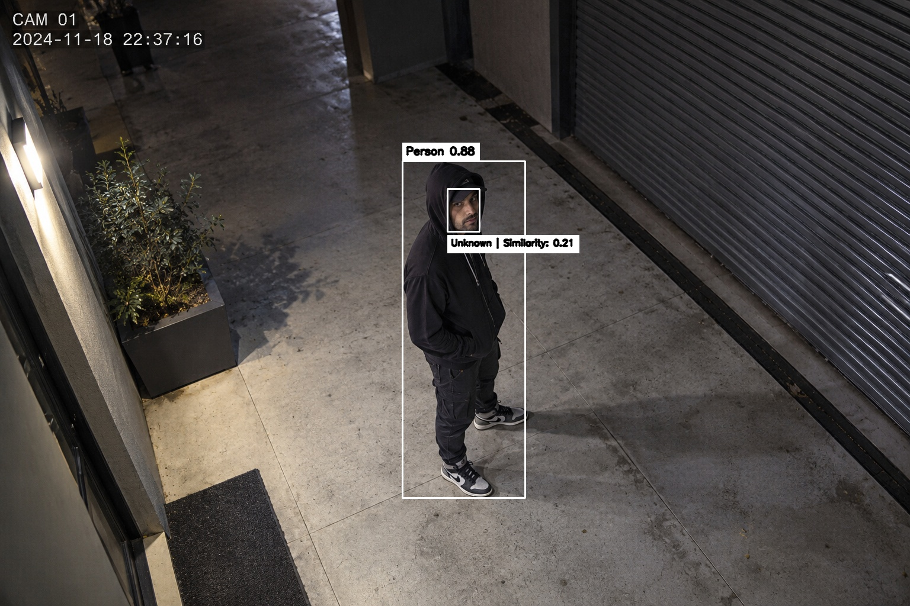

# Open Security Cam System

An open-source AI security camera. It watches a live feed, recognizes the registered owner, and sends a Telegram alert with a photo when an unknown person stays in view.



## Overview

The idea behind this project is to develop an open-source smart camera system that can run on a wide range of devices.

Open Security Cam System uses pretrained models only, so there is nothing to train. YOLO26 finds and tracks people, MTCNN finds the face inside each person, and a FaceNet model compares that face with the face you registered. If someone is not recognized and stays in view for 5 seconds, the system sends an alert to your Telegram and logs the event.

Each person on screen gets one of these labels:

| Label | Color | Meaning |
|-------|-------|---------|
| Owner | Green | The face matches the registered face (similarity 0.70 or higher) |
| Unknown | Red | A face was found, but it doesn't match the registered face |
| Unverified | Orange | A face was found but couldn't be compared (for example, no registered face yet) |
| Face Not Found | Orange | No face was detected on the person |

## Features

- Person detection and tracking with YOLO26n and ByteTrack, so each person keeps an ID across frames
- Face detection with MTCNN, run only inside each person's bounding box
- Face recognition with FaceNet (InceptionResnetV1, trained on VGGFace2): the face is turned into an embedding and compared with the registered one by cosine similarity
- Simple face registration: capture your face from the webcam with one key press
- FP16 inference engine to reduce computational requirements on devices with limited resources
- Countdown on screen ("Alert in: ...") while an unknown person stays in view
- Telegram alert with the details and a photo after an unknown person stays in view
- Alert cooldown, and one alert per tracked person
- Every alert is logged to a local SQLite database

## How It Works

1. **Register the owner.** `register_face.py` opens the webcam. Press `s` to capture your face. The photo is saved as `my_face.jpg` and its face embedding is saved as `my_face.npy`.
2. **Detect and track people.** In `main.py`, YOLO26n with ByteTrack detects people (COCO class 0) in each frame.
3. **Find the face.** Each person is cropped, and MTCNN looks for a face in the crop. Faces below 0.90 confidence are ignored.
4. **Compare.** The face embedding is compared with the registered embedding. A similarity of 0.70 or higher means Owner. Anything lower means Unknown.
5. **Count.** While a tracked person stays Unknown, a 5-second timer runs. If the person is recognized again or leaves the view, the timer resets.
6. **Alert.** After 5 seconds, the system saves the frame, sends a Telegram message (detection confidence, face similarity, and time) plus the photo, and logs the event to SQLite.

## Model

I used the pretrained YOLO26n model to take advantage of its existing capabilities and performance. Since the model is trained on the COCO dataset, I configured the system to use only the `person` class.

The face detection step processes a crop of the detected person, because my original idea was to save an image of the entire person rather than just their face.

Alternatively, you can use face crops instead of full-person crops to reduce the amount of image data processed and potentially improve processing speed, depending on the rest of the pipeline.

## Inference Engine and Quantization

I converted the model from PyTorch to an inference engine (TensorRT) and used FP16 quantization instead of FP32 to reduce computational requirements while maintaining good performance. This makes the system more suitable for devices with limited resources, such as the NVIDIA Jetson Orin Nano. Devices without an NVIDIA GPU, such as the Raspberry Pi, can use the `.pt` file or another export format supported by Ultralytics, for example NCNN or ONNX.

If you want higher speed and lower computational requirements, you can try INT8 quantization. However, I cannot guarantee that the accuracy will remain the same, so I recommend testing it before using it.

## Settings

These are set at the top of `main.py`. They are the values I found suitable for my use case, but you can adjust them according to your needs, for example `similarity_threshold` and `alert_time`.

| Setting | Default | What it does |
|---------|---------|--------------|
| `similarity_threshold` | 0.70 | Minimum face similarity to count as the owner |
| `face_confidence` | 0.90 | Minimum MTCNN confidence for a detected face |
| `alert_time` | 5 | Seconds a person must stay Unknown before an alert is sent |
| `alert_cooldown` | 10 | Minimum seconds between two alerts |

## Database

`user.db`, table `user`:

| Column | Type | Description |
|--------|------|-------------|
| id | INTEGER PRIMARY KEY | Alert ID |
| date | TEXT | Date and time of the alert |
| conf | REAL | Person detection confidence at the time of the alert |

## Telegram Integration

The system connects directly to Telegram to make it more user-friendly and allow you to receive notifications.

### How to connect Telegram

1. Open Telegram and search for @BotFather.
2. Create a new bot by sending `/newbot`. Follow the instructions to choose a name and username for your bot.
3. Copy the bot token and paste it into the `TOKEN` variable in `telegram_alert.py`.
4. Send a message to your newly created bot.
5. Open the following URL in your browser, replacing `YOUR_BOT_TOKEN` with your actual bot token:
   `https://api.telegram.org/botYOUR_BOT_TOKEN/getUpdates`
6. Find the `chat` object in the response and copy the value of its `id` field.
7. Paste the chat ID into the `CHAT_ID` variable in `telegram_alert.py`.

**Important:** Keep your bot token private and do not upload it to a public GitHub repository.

## Getting Started

### Install

```bash
git clone https://github.com/i0nlyaziz/Open-Security-Cam-System.git
cd Open-Security-Cam-System
pip install -r requirements.txt
```

### Model weights

The YOLO model isn't stored in the repo. Download `yolo26n.pt` from the [Releases page](https://github.com/i0nlyaziz/Open-Security-Cam-System/releases) and place it in the `weights/` folder.

`main.py` loads a TensorRT engine, `weights/yolo26n.engine`. Engines only work on the GPU they were built on, so export your own with FP16:

```python
from ultralytics import YOLO
YOLO("weights/yolo26n.pt").export(format="engine", half=True)
```

If you don't have an NVIDIA GPU, change the model path in `main.py` to `weights/yolo26n.pt` instead.

The face models download automatically the first time you run the system: MTCNN comes with the `facenet-pytorch` package, and the FaceNet weights are downloaded on first use.

### Register your face

```bash
python register_face.py
```

Look at the camera and press `s` to save your face. Press `q` to cancel. You only need to do this once.

### Connect Telegram

Follow the steps in [Telegram Integration](#telegram-integration) above.

### Run

```bash
python main.py
```

This opens the webcam and shows the annotated feed in a window. Press `q` to quit.

## Project Structure

```
Open-Security-Cam-System/
├── README.md
├── LICENSE
├── requirements.txt
├── .gitignore
├── main.py                 # detection, tracking, face check, and alerts
├── face_system.py          # face embeddings and comparison
├── register_face.py        # registers the owner's face
├── telegram_alert.py       # Telegram message and photo alerts
├── database.py             # SQLite logging
├── weights/
│   ├── yolo26n.pt          # person detection model (not tracked in git, see above)
│   ├── yolo26n.engine      # TensorRT version, exported on your machine (not tracked in git)
│   └── README.md
└── results/
    └── demo.jpg            # sample output
```

These files are created while the system runs and are not part of the repo: `my_face.jpg`, `my_face.npy`, `unknown_person.jpg`, and `user.db`.

## Tech Stack

Ultralytics YOLO26, ByteTrack, facenet-pytorch (MTCNN and InceptionResnetV1), PyTorch, OpenCV, NumPy, Requests (Telegram Bot API), SQLite, TensorRT (optional)

## Privacy and Security

- Your registered face (`my_face.jpg`, `my_face.npy`), the alert photos, and the database stay on your machine. They are excluded from the repo.
- This system processes faces. Use it only where you are allowed to, and follow your local laws about cameras and biometric data.

## Potential Issues

- **Camera placement:** Make sure the camera is positioned at a suitable angle and in a location with adequate lighting. These factors can significantly affect detection performance.
- **Resolution:** Higher video resolutions generally require more computational resources and can increase processing time.
- **Hardware limitations:** Performance depends on the device, inference engine, and available hardware acceleration.

The system is designed to be adaptable, so feel free to experiment with the settings and modify them to suit your requirements.

## Limitations

- Only one face can be registered, so only one person is recognized as the owner. Everyone else is treated as Unknown.
- Only the first valid face found on each person is checked.
- Alerts are sent through Telegram, so the system needs an internet connection to notify you.
- Each tracked person triggers one alert. If tracking loses a person and gives them a new ID, they can trigger a new alert after the cooldown.
- `unknown_person.jpg` is overwritten at every alert, so only the latest alert photo is kept on disk.

## License

MIT, see [LICENSE](LICENSE) for details.